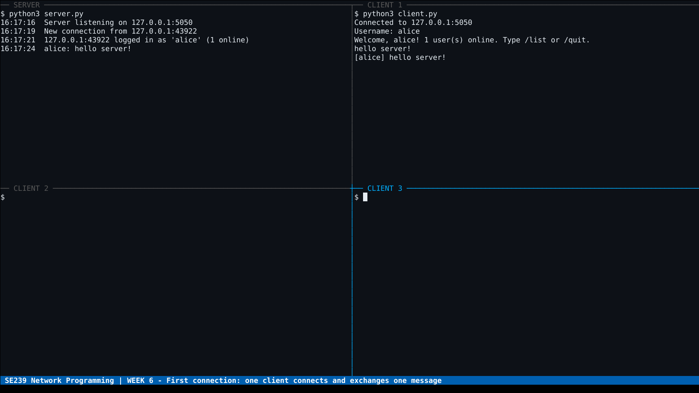
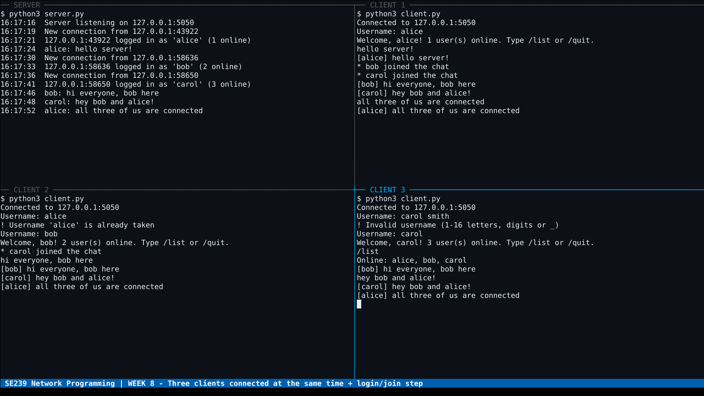
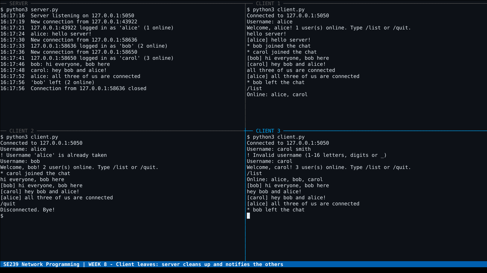

# Deliverable 2: Week 6 and Week 8 Evidence

Demo video: [`evidence/demo.mp4`](evidence/demo.mp4) (about 53 s). It shows the
server (top left) and three clients running at the same time on one machine.

## Week 6: First connection working

> One client can connect to the server and exchange one simple message.



1. The server starts and listens on `127.0.0.1:5050`.
2. Client 1 connects. The server logs `New connection from 127.0.0.1:<port>`.
3. The client logs in as `alice` and the server answers `WELCOME`.
4. Alice sends `hello server!`. The server logs it and sends it back as
   `[alice] hello server!`, which completes a full client → server → client round trip.

## Week 8: Multiple clients working (midpoint check)

> At least 3 clients are connected to the server at the same time.
> The basic login/join step works.



- **Three clients at once:** the server log shows `alice` (1 online), `bob`
  (2 online) and `carol` (3 online). Carol's `/list` returns `alice, bob, carol`.
  Messages from each client reach all three.
- **Login/join step:**
  - Client 2 tries the name `alice`. It is rejected with `Username 'alice' is already taken`.
    It then joins as `bob`.
  - Client 3 tries `carol smith`. It is rejected as an invalid username, then joins as `carol`.
  - Before a client has joined, the server accepts no chat messages
    (covered by `test_must_join_before_chatting`).
  - The other clients are told when someone joins: `* bob joined the chat`.



- **Leaving:** Bob types `/quit`. The server removes him (`'bob' left (2 online)`),
  closes the connection and notifies the others (`* bob left the chat`). Alice's
  `/list` now shows only `alice, carol`.

## Automated tests

```
$ python3 -m unittest discover -s tests -v
test_duplicate_and_invalid_usernames_rejected ... ok
test_must_join_before_chatting ... ok
test_quit_notifies_others ... ok
test_single_client_exchanges_message ... ok
test_three_clients_connected_at_once ... ok
Ran 5 tests ... OK
```
